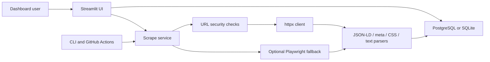

# Price Monitor Dashboard

Internal Streamlit dashboard for monitoring exact product-page URLs across retail stores, saving historical price observations, and comparing the latest valid prices.

## Screenshots

Screenshots should be added after the first production deployment:

- Overview dashboard
- Product and listing editor
- Price history chart
- Scrape run history

## Features

- Product, store, and listing management
- Exact URL monitoring for each product listing
- Manual dashboard scraping and CLI scraping
- Scheduled GitHub Actions workflow every six hours
- JSON-LD, meta tag, CSS selector, text fallback, and optional Playwright extraction
- Historical observations for every attempt
- Failed and stale listing visibility
- Current comparison and history CSV exports
- Streamlit password gate for production
- SQLAlchemy models and Alembic migrations
- SQLite local fallback and PostgreSQL production support
- Docker and Render free web service configuration

## Architecture



## Technology Stack

- Python 3.12+; tested locally with Python 3.13
- Streamlit
- Pandas and Plotly
- SQLAlchemy 2.x and Alembic
- PostgreSQL in production; SQLite for local fallback
- httpx, Beautiful Soup, and optional Playwright Chromium
- Pytest and Ruff
- Docker
- GitHub Actions
- Render web service
- Neon PostgreSQL

## Repository Structure

```text
app.py
src/price_monitor/
  config.py
  database.py
  models.py
  security.py
  cli.py
  repositories/
  services/
  scraping/
  ui/
migrations/
scripts/
tests/
.github/workflows/
```

## Local Installation

Create a local `.env` from `.env.example` and adjust values as needed. Do not commit `.env`.

### Windows PowerShell

```powershell
python -m venv .venv
.\.venv\Scripts\Activate.ps1
python -m pip install --upgrade pip
python -m pip install -r requirements-dev.txt
python -m pip install -e .
alembic upgrade head
python -m price_monitor.cli seed-demo
streamlit run app.py
```

### Unix or macOS

```bash
python -m venv .venv
. .venv/bin/activate
python -m pip install --upgrade pip
python -m pip install -r requirements-dev.txt
python -m pip install -e .
alembic upgrade head
python -m price_monitor.cli seed-demo
streamlit run app.py
```

## Docker Usage

```bash
docker build -t price-monitor-dashboard .
docker run --rm --env-file .env -p 8501:8501 price-monitor-dashboard
```

For local PostgreSQL:

```bash
docker compose up --build
```

## Environment Variables

See `.env.example` for the complete list. Production requires:

- `APP_ENV=production`
- `DATABASE_URL`
- `AUTH_DISABLED=false`
- `APP_PASSWORD_HASH`

Generate a password hash:

```bash
python -m price_monitor.cli hash-password "your-password"
```

## Database Migrations

Run migrations locally or in deployment:

```bash
alembic upgrade head
```

The Docker start command runs migrations before starting Streamlit. Avoid automatic demo seeding in production.

## Demo Seeding

Demo data is fictitious and does not scrape live stores:

```bash
python -m price_monitor.cli seed-demo
```

## Running the Scraper

```bash
python -m price_monitor.cli scrape --all --trigger manual_cli
python -m price_monitor.cli scrape --product-id 1
python -m price_monitor.cli scrape --listing-id 1
python -m price_monitor.cli healthcheck
```

## Adding a Store

1. Create the store in the dashboard with its domain and default currency.
2. Start with the `generic` adapter.
3. Add exact product-page URLs as listings.
4. If structured data is missing, add CSS selectors for price, regular price, availability, and title.
5. If HTTP HTML does not contain the rendered price and policy allows automation, set the store or listing method to browser.

## Adding a Custom Adapter

Create a module under `src/price_monitor/scraping/adapters/`, implement the `StoreAdapter` protocol, and register it in `src/price_monitor/scraping/registry.py`. Keep store-specific selectors and behavior inside the adapter so dashboard logic remains unchanged.

## CSS Selectors

Selectors are listing-specific overrides. Prefer stable product metadata when available. Use selectors only when the site does not expose JSON-LD or price meta tags.

## GitHub Actions Scheduling

`.github/workflows/scrape-prices.yml` runs at `0 */6 * * *` UTC and supports `workflow_dispatch`. Configure repository secrets:

- `DATABASE_URL`
- `APP_PASSWORD_HASH` if production settings are reused by the workflow

The workflow records individual listing failures without failing the entire run unless the run cannot start.

The scheduled workflow does not serve the dashboard UI, so it only requires `DATABASE_URL`. The dashboard password hash belongs in Render's environment variables.

## Neon Setup

1. Create a Neon free project and a dedicated database.
2. Copy the pooled or direct SSL connection string.
3. Store it in local `.env`, Render environment variables, and GitHub Actions secrets as `DATABASE_URL`.
4. Run `alembic upgrade head`.
5. Verify with `python -m price_monitor.cli healthcheck`.

Never commit or print the full database URL.

## Render Deployment

Use `render.yaml` to create a free Docker web service. Required Render environment variables:

- `DATABASE_URL`
- `APP_PASSWORD_HASH`
- `APP_ENV=production`
- `AUTH_DISABLED=false`

Health check path:

```text
/_stcore/health
```

The service does not use Render persistent disk. PostgreSQL state must live in Neon or another managed PostgreSQL service.

## Authentication

Production uses a single password hash in `APP_PASSWORD_HASH`. This is intentionally simple for an internal MVP. Place the hash in Render environment variables and do not store the raw password.

## Troubleshooting

- `DATABASE_URL is required in production`: set Render or local environment variables.
- `APP_PASSWORD_HASH is required`: generate a hash and set it when auth is enabled.
- `price_not_found`: inspect the page source and add selectors or enable browser extraction when appropriate.
- `captcha_detected`: the site requires unsupported manual verification.
- Docker build fails during browser install: retry after network recovery or verify the base image can access Playwright downloads.

## Free-Tier Limitations

- Render free services may sleep after inactivity and cold starts can be slow.
- Render free web services should not be used for durable local files.
- GitHub Actions schedule timing is not guaranteed to the minute.
- Neon free tiers have storage, compute, and inactivity constraints.
- Cloud-hosted IPs can be blocked by some stores.

## Security and Responsible Scraping

This project is for legitimate internal product-price research. Respect website terms, robots.txt where appropriate, rate limits, authentication boundaries, privacy, copyright, and applicable laws. Prefer official APIs or product feeds when available.

The application blocks common SSRF targets, including local, private, link-local, reserved, multicast, metadata, non-HTTP, credentialed, and unusual-port URLs. It does not include CAPTCHA bypassing, proxy rotation, fake identity rotation, or login automation.

## Known Limitations

Exact selectors and extraction rules can break when a retailer changes its website. Some stores may block cloud-hosted IP addresses, require JavaScript, require authentication, present CAPTCHAs, prohibit automation, show region-specific prices, show prices only after selecting variants, separate marketplace sellers, or require shipping-location information.

The MVP does not perform web-wide discovery, currency conversion, multi-user roles, or official retailer API integrations.

## Future Improvements

- Store-specific adapters for priority retailers
- Variant and shipping-location support
- Currency conversion through an approved source
- Multi-user authentication and audit trails
- Alerting when prices cross target thresholds
- Official retailer feed/API integrations

## Verification Commands

```bash
ruff check .
ruff format --check .
pytest -v
alembic upgrade head
docker build -t price-monitor-dashboard .
python -m price_monitor.cli healthcheck
git status
git log --oneline -10
```
